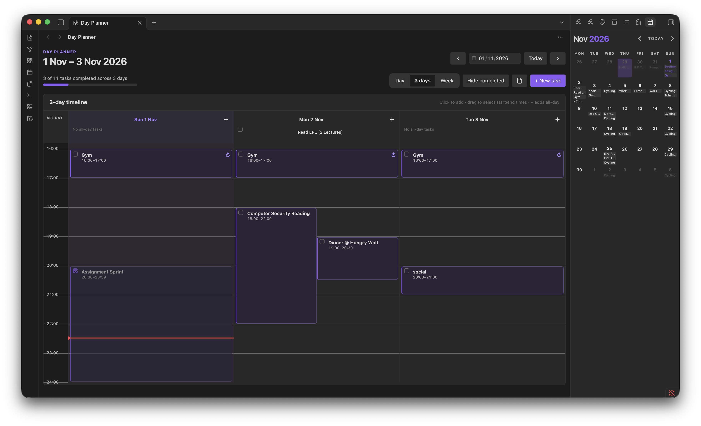
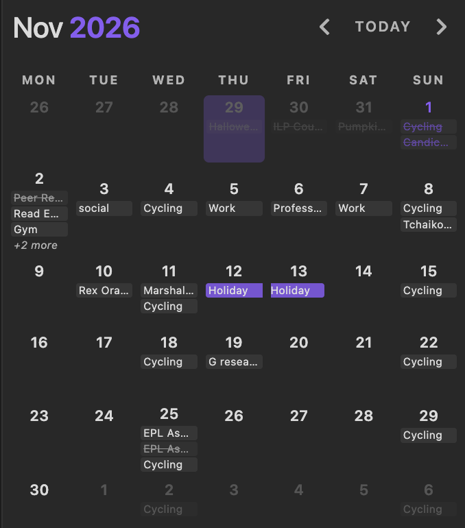
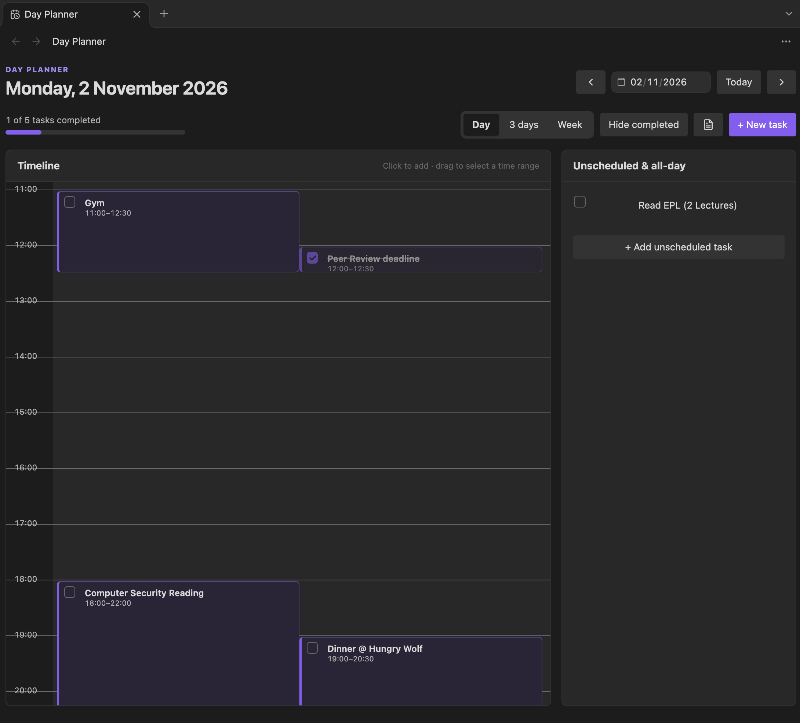
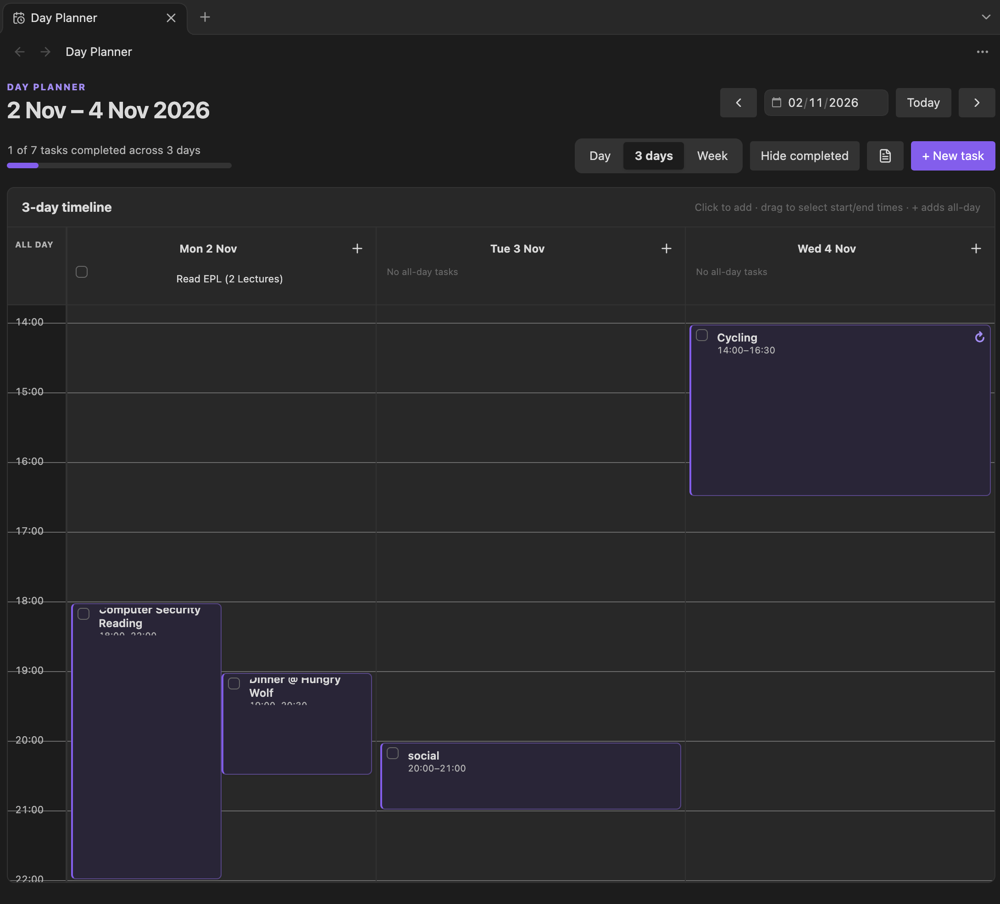
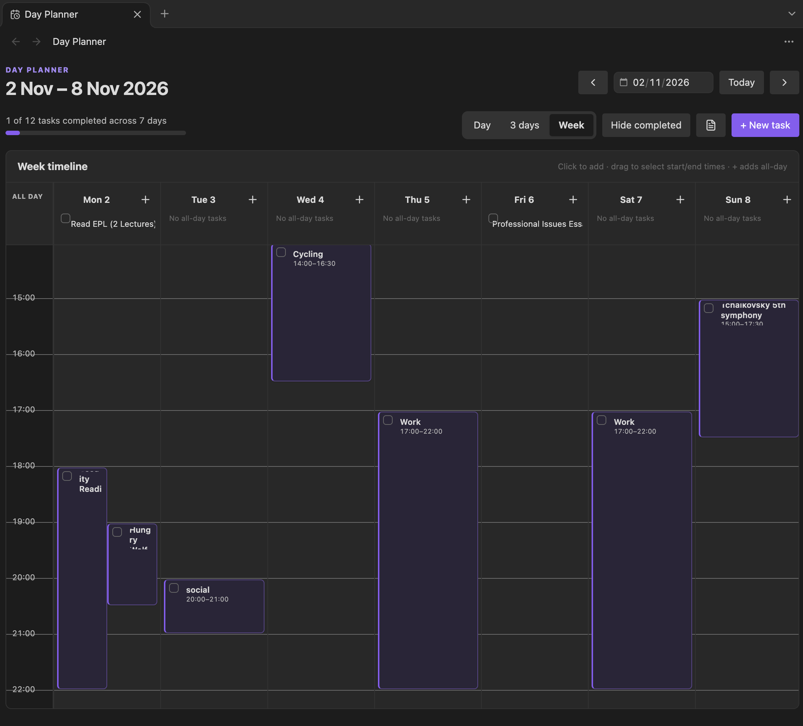
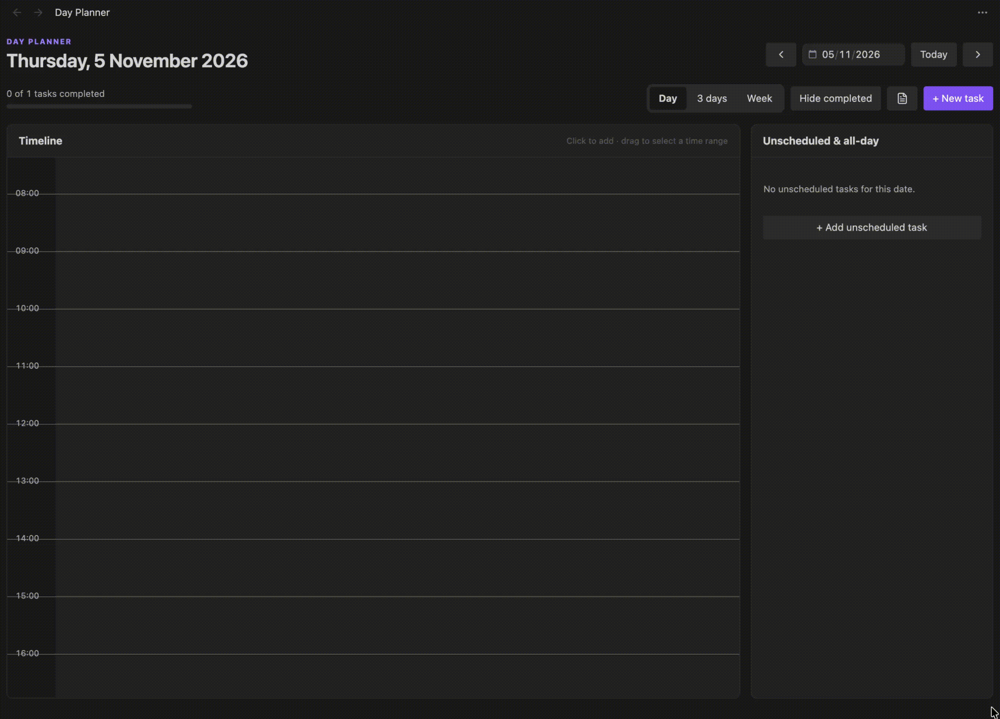
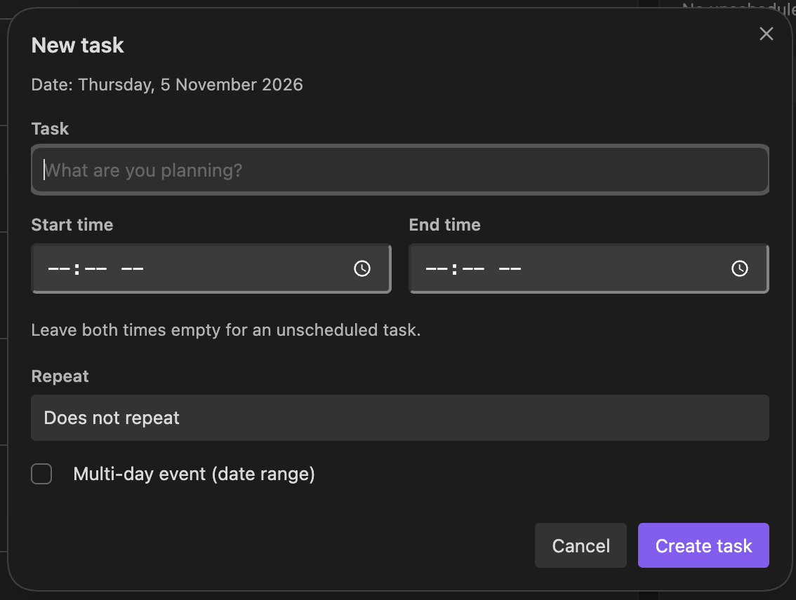
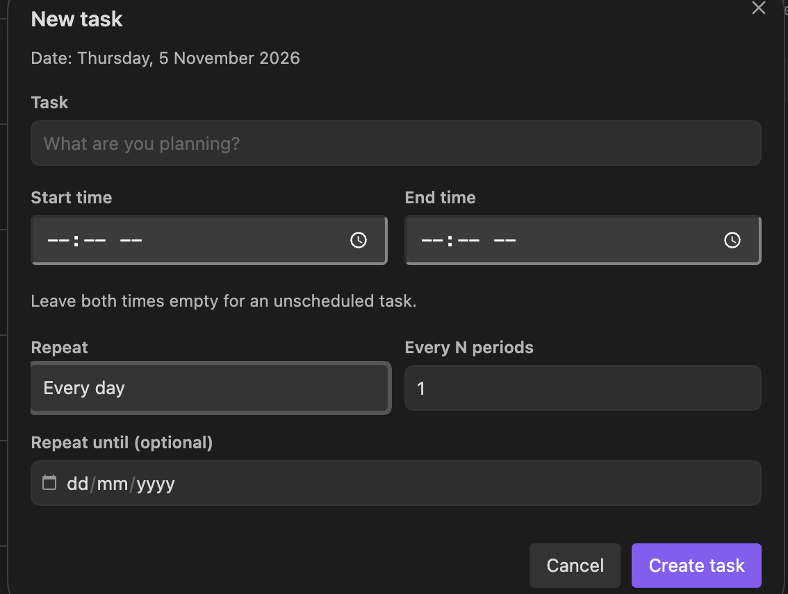
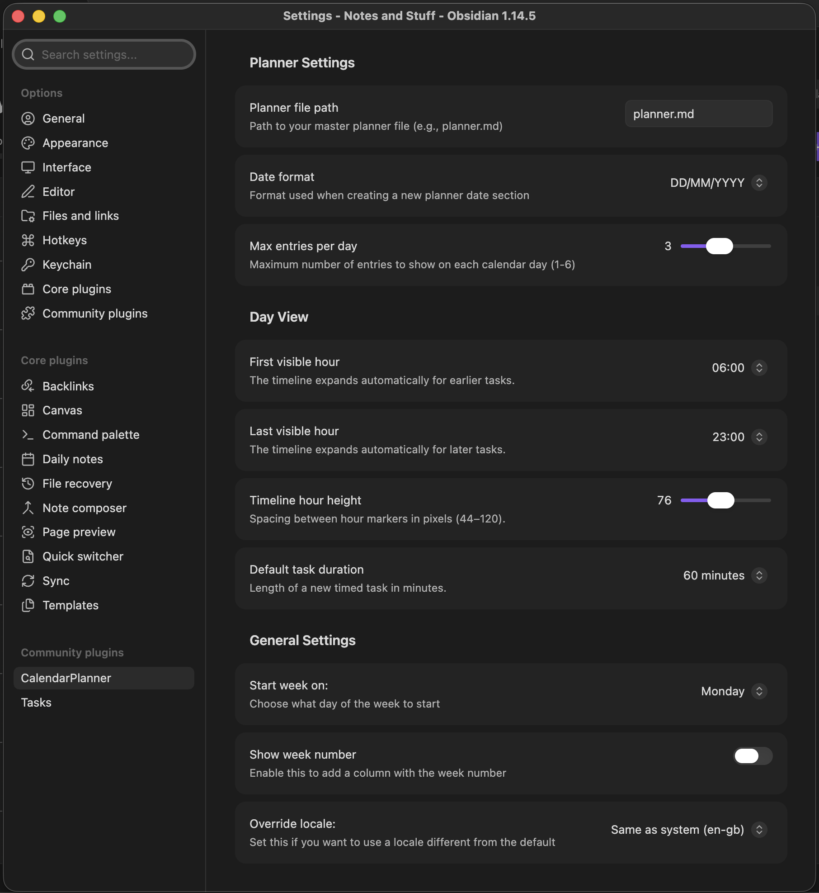

# Obsidian Calendar Planner

A modified version of the [Obsidian Calendar Plugin](https://github.com/liamcain/obsidian-calendar-plugin) that keeps your schedule in **one Markdown file** instead of individual daily notes.

Calendar Planner combines a monthly calendar with a **day timeline**, **3-day planner**, and **full-week planner**. Schedule tasks by clicking or dragging across the timeline, manage recurring tasks, and check things off without leaving Obsidian.



> [!NOTE]

> **Calendar Planner** is a separate Obsidian community plugin from **Obsidian Day Planner**. Its timeline layout is inspired by day-planning workflows, but calendar sync, time tracking, and third-party task integration are not included.

## Features

- **One master planner file** — Tasks, notes, timed blocks, date ranges, and recurrence rules live in `planner.md` (or another Markdown file you select).

- **Monthly calendar** — See real entry previews instead of dots, with completion states, multi-day highlighting, and an overflow indicator.

- **Three timeline layouts** — Switch between **Day**, **3 days**, and **Week (7 days)**. Your selected layout is remembered.

- **Drag to create tasks** — Select an empty time range with a mouse or stylus; the task editor opens with the correct date and start/end times.

- **15-minute snapping** — Create precise blocks by dragging in either direction, with a live selection preview.

- **Visible hourly grid** — Distinct hour boxes and separators remain visible in all three timeline layouts, with theme-aware colours.

- **Task editing and completion** — Create, edit, delete, and check off tasks from the timeline, calendar, and unscheduled list.

- **Recurring tasks** — Repeat daily, on weekdays, weekly, monthly, or yearly; use custom intervals and optional end dates. Completion is tracked separately per occurrence.

- **Unscheduled and all-day items** — Keep untimed tasks, notes, and date-range items alongside scheduled work.

- **Multi-day entries** — Display items across a date range without copying them into several daily sections.

- **Markdown-first storage** — Continue using familiar checkboxes and date headings; no separate task database is required.

## Screenshots and views

### Month view

The original calendar is still available. Each date can display task text, completed-task styling, multi-day highlights, and a `+N more` indicator when a day has more entries than the configured limit.

Click a date to open its timeline Day View. Right-click a date for the **Quick edit (popup)** and other options.



### Day view

A single-day planner with a detailed hourly timeline, clearly separated hour boxes, timed task blocks, and an **Unscheduled & all-day** panel. Today's column includes a current-time indicator. Overlapping tasks are laid out so both remain accessible.



### 3-day view

See the selected date plus the next two days side by side. Each day has its own timeline, unscheduled items, and an add-task button. Selecting a time range in a column creates a task for **that column's date**.



### Week view

See the entire **Monday–Sunday** week in seven columns. On narrow screens, scroll horizontally to reach the other dates. The general calendar's **Start week on** setting does not change the timeline Week view's Monday–Sunday alignment.



## Installation

Calendar Planner is available through **Obsidian's Community Plugins browser**. You do not need to download files from GitHub or manually copy `main.js` or `styles.css` into your vault.

### Install Calendar Planner

1. Open **Obsidian** and go to **Settings → Community plugins**.
2. If community plugins are not enabled yet, follow the on-screen prompt to turn them on.
3. Select **Browse** and search for **Calendar Planner**.
4. Open the **Calendar Planner** plugin listing and click **Install**.
5. Once installation finishes, click **Enable** (or enable it from the installed plugins list).
6. Go to **Settings → Calendar Planner** and confirm the **Planner file path**. By default, the plugin uses `planner.md` in your vault root; create that file if it does not already exist.
7. Open the planner using its ribbon icon or the **Open calendar planner** command.


### Update Calendar Planner

To get new features and bug fixes, open **Settings → Community plugins**, select **Check for updates**, and install the update for **Calendar Planner** if one is available. Reload Obsidian if changes do not appear immediately.

Your existing `planner.md` file and plugin settings do not need to be replaced to update the plugin. Backing up your vault before major updates is still recommended.

> [!NOTE]
> **Calendar Planner** is a separate plugin from **Obsidian Day Planner**. Install or update Calendar Planner from its own Community Plugins listing.

## Getting started

1. Open **Calendar Planner** using the calendar view or the command palette command **Open calendar planner**.

2. Click any date to open its **Day View**.

3. Use the **Day / 3 days / Week** controls to choose your planning layout.

4. Click an empty time slot for a quick timed task, or drag across a time range for an exact duration.

5. Give the task a title, optionally configure repetition, then choose **Create task**.

6. Check off completed tasks directly in the timeline or unscheduled panel. Changes are saved to `planner.md`.

### Creating a task by dragging

Drag-to-create is available in all three timeline layouts:

1. Move the pointer to an **empty** area of the timeline at the intended start time.

2. Press and hold the primary mouse button, then drag down (or up) to the end time.

3. Watch the highlighted selection and time preview. The bounds snap to **15-minute increments**.

4. Release the pointer. **New task** opens with the date and both times filled in.

5. Enter a task name and select **Create task** to save.

For example, dragging from **12:00 to 13:30** opens the editor with **Start time: `12:00`** and **End time: `13:30`**.



**Other interactions:**

- **Single click on an empty slot:** Opens a task with the configured default duration (60 minutes by default).

- **Drag upward:** Works the same way as dragging downward.

- **Drag near a timeline edge:** Scrolls automatically to allow a longer selection.

- **Press `Esc` while dragging:** Cancels the range selection.

- **Click an existing task:** Opens it for editing; dragging starts only on empty timeline space.

- **Touchscreen:** Tap-to-create and scrolling are supported; drag-to-select is intended for mouse and stylus rather than finger gestures.

A drag only opens the editor; it does **not** save a task until you submit the form. Time selections stay within one day, with **23:59** as the latest supported end time.

### Managing tasks

The task editor supports a title, optional start/end times, recurrence settings, and a multi-day date range (for non-recurring entries). Leave both time fields empty for an unscheduled task.

- **Timed tasks:** Appear on the hourly grid; overlapping tasks can coexist.

- **Unscheduled tasks and notes:** Appear in the unscheduled/all-day area.

- **Completion:** Tick a checkbox directly from the view; use **Hide completed** to reduce clutter.

- **Editing:** Select an existing task to update it. Editing a recurring instance updates its **series**.

- **Deletion:** Delete an ordinary task, delete an entire recurring series, or choose **Skip this date** for one recurring occurrence.

- **Navigation:** Use arrows, the date picker, or **Today**. Arrows advance by 1, 3, or 7 days according to the selected layout. Click a multi-day column heading to open that date in Day View.



## Recurring tasks

Create a task that repeats **daily**, on **weekdays (Monday–Friday)**, **weekly**, **monthly**, or **yearly**. Weekly, monthly, yearly, and daily rules can use **Every N periods** (for example, every 2 weeks); an optional **Repeat until** date limits the series.

Recurring tasks begin at the date section containing their original entry. Each occurrence is shown on its matching calendar date without adding duplicate task lines.

**Individual completion:** Completing one recurring occurrence does not complete every future occurrence. Completing a later instance stores its date in a `[done:: ...]` list on the original task. Skipping an instance adds its date to `[except:: ...]`.



### Recurrence syntax in Markdown

These are valid examples of the stored format:

```markdown

**31/10/2026**

- [ ] 09:00 - 09:30 Stretch and plan [repeat:: daily] [pid:: example-1]

- [ ] 14:00 - 15:00 Project work [repeat:: weekdays] [until:: 2026-12-31] [pid:: example-2]

- [ ] Weekly review [repeat:: weekly] [every:: 2] [pid:: example-3]

- [ ] Read a book

```

\| Field | Purpose | Example |

\|---|---|---|

\| `[repeat:: ...]` | Repetition rule: `daily`, `weekdays`, `weekly`, `monthly`, `yearly` | `[repeat:: weekly]` |

\| `[every:: ...]` | Repeat every N periods (not used for weekdays) | `[every:: 2]` |

\| `[until:: ...]` | Last date on which the task may repeat | `[until:: 2026-12-31]` |

\| `[done:: ...]` | Completed occurrence dates | `[done:: 2026-11-07, 2026-11-14]` |

\| `[except:: ...]` | Skipped occurrence dates | `[except:: 2026-11-21]` |

\| `[pid:: ...]` | Internal ID for reliably matching a task to its Markdown line | `[pid:: example-3]` |

The `pid` values above are **illustrative**. The task editor generates its own unique IDs; you do not need to supply them manually.

**Important behaviour:** Monthly tasks on the 29th–31st are omitted in months without that date. A yearly task on February 29 is omitted in non-leap years. Repeating and multi-day date ranges are separate entry types in the task editor.

## Planner file format

By default, all entries are read from **`planner.md`** in your vault root. You can change that path in **Settings → Calendar Planner**.

### Date headings

Both `DD/MM/YYYY` and `YYYY-MM-DD` are supported, with bold or second-/third-level Markdown headings:

```markdown

**21/03/2026**

**2026-03-21**

## 21/03/2026

### 2026-03-21

```

Use **one heading per date section** in real files; the examples above show the acceptable alternatives. The date-format setting controls the format of **newly created** sections.

### Standard entries and checkboxes

```markdown

**21/03/2026**

1) Review documents

2) Send emails

- Bullet point entry

* Another bullet style

- [ ] Submit report

- [x] Call dentist

[x] Checkbox without a bullet

A plain-text note

```

Supported checkbox prefixes include `- [ ]`, `* [ ]`, `[ ]`, and numbered forms such as `1) [ ]`. Use `[x]` for completed items.

### Timed tasks

Prefix an entry with a 24-hour start/end time:

```markdown

**22/03/2026**

- [ ] 09:00 - 11:00 Work on project

- [ ] 13:30 - 14:00 Team meeting

- [ ] 16:00 Reply to emails

- [ ] Review notes [time:: 18:00-18:45]

```

A task with only a start time (for example, `16:00 Reply to emails`) uses **60 minutes** when parsed into the timeline. For exact durations, provide both times or use the task editor. Times use 24-hour `HH:MM` notation.

### Multi-day entries

Use a bracketed range to display an entry across several calendar days:

```markdown

**21/03/2026**

- [ ] Conference trip [21/03 - 23/03]

- [ ] Project deadline [21/03/2026 - 25/03/2026]

1) Holiday [15/03 - 20/03]

```

\| Format | Meaning |

\|---|---|

\| `[DD/MM - DD/MM]` | Uses the year of the entry's date section |

\| `[DD/MM/YYYY - DD/MM/YYYY]` | Specifies both years explicitly |

Multi-day entries appear on dates in the range. The original monthly calendar visually highlights them; the legacy quick-edit popup displays their range information.

## Settings

Open **Settings → Calendar Planner**.

\| Setting | Description | Default |

\|---|---|---|

\| **Planner file path** | Master Markdown file path | `planner.md` |

\| **Date format** | Date format used for new sections | `DD/MM/YYYY` |

\| **Max entries per day** | Entry previews in each calendar cell (1–6) | `3` |

\| **First visible hour** | Starting hour of the planner timeline | `06:00` |

\| **Last visible hour** | Ending hour of the planner timeline | `23:00` |

\| **Timeline hour height** | Pixel height per hour (44–120) | `76` |

\| **Default task duration** | New timed-task duration for a click (15, 30, 45, 60, 90, 120 minutes) | `60 minutes` |

\| **Start week on** | First weekday of the **monthly calendar** | Locale default |

\| **Show week number** | Show week-number column on the monthly calendar | Off |

\| **Override locale** | Choose a calendar locale | System default |

The timeline automatically expands to include tasks outside the configured first/last visible hours. Your **Day / 3 days / Week** selection is also remembered between sessions.



## Commands and navigation

Open the command palette with `Ctrl/Cmd + P`:

\| Command | Action |

\|---|---|

\| **Open calendar planner** | Open the monthly calendar |

\| **Open Day View** | Open the timeline planner |

\| **Open today's Day View** | Jump directly to today's timeline |

\| **Add timed planner task** | Open the timed task editor for today |

\| **Open planner file** | Open the configured Markdown file |

\| **Add entry for today** | Quick-add an entry to today's section |

The **calendar-clock ribbon icon** opens the Day View. In the month view, click a date for Day View or right-click it for **Open Day View**, **Quick edit (popup)**, **Add Entry**, and (when applicable) **Open in Planner**.

## Example workflow

Create `planner.md` with a few tasks:

```markdown

**02/11/2026**

- [ ] 09:00 - 10:00 Morning planning [repeat:: weekdays]

- [ ] 10:30 - 12:00 Deep work

- [ ] Review pull requests

- [ ] Project launch [02/11/2026 - 04/11/2026]

**03/11/2026**

- [ ] 14:00 - 15:00 Project check-in

- [ ] Buy groceries

```

Open **Day View** for 2 November, then switch to **3 days** to see the project launch across its date range. Drag across a free time interval to schedule another block. Switch to **Week** to review the Monday–Sunday schedule. Check off individual tasks as you go; the master Markdown file stays the source of truth.

## Differences from the original Obsidian Calendar plugin

\| Feature | Original calendar plugin | Calendar Planner |

\|---|---|---|

\| Data source | Daily/weekly notes | Single configurable `planner.md` |

\| Month display | Note/activity indicators | Task text previews, completion state, and multi-day entries |

\| Date click | Opens the associated daily note | Opens the planner Day View |

\| Timeline | Not part of the base calendar | Day, 3-day, and Week layouts |

\| Creating timed tasks | No timeline-based drag creation | Click or drag-select a range |

\| Repeating tasks | Not managed in the calendar itself | Markdown recurrence rules with per-date completion |

\| Task completion | Generally handled in notes | Toggle directly in planner views |

## Troubleshooting

### My tasks or dates are missing

- Confirm the planner path points to the correct Markdown file.

- Check that date headings use `**DD/MM/YYYY**`, `**YYYY-MM-DD**`, `## ...`, or `### ...`.

- Check timed task syntax (`09:00 - 10:00 Task`) and recurrence metadata for typos.

- Close and reopen the view, or reload Obsidian (`Ctrl/Cmd + R`).

### The New task window is empty

Open **Settings → Community plugins**, check for updates, and update **Calendar Planner** if a newer version is available. Then reload Obsidian and try creating a task again.

### The hourly boxes or separators are invisible

Update **Calendar Planner** through **Settings → Community plugins → Check for updates**. The hour-grid styling fix is included in newer releases; reload Obsidian after updating.

### Dragging doesn't open a task

- Start the drag in an **empty** hour slot rather than on an existing task block.

- Use a **mouse or stylus**; finger dragging is reserved for natural scrolling.

- Drag far enough to select at least a 15-minute interval and release the pointer.

- Check for an available **Calendar Planner** update under **Settings → Community plugins**.

### A recurring task appears completed on the wrong date

Recurrence completion is stored per occurrence. Check the original task line for `[done:: ...]` and `[except:: ...]` dates, and confirm that the `[repeat:: ...]` and optional `[until:: ...]` rules match your intention. Keep the generated `[pid:: ...]` IDs intact when editing by hand.

### The planner doesn't refresh after editing Markdown

Reopen the planner or reload Obsidian. Views are designed to reparse the master file when it changes, but other vault plugins or external editors may affect the timing of refreshes.

## Limitations

- Calendar Planner is installed and updated through **Obsidian Community plugins**, separately from **Obsidian Day Planner**.

- There is **no built-in Google Calendar/ICS sync**, time tracking, or Obsidian Tasks integration.

- You can **drag to create** a new task, but you cannot yet drag an existing task block to reschedule it; click the block and edit its times instead.

- Drag-to-select is intended for **mouse and stylus**, not touch gestures.

- Recurring-series edits affect the whole series; use **Skip this date** to omit one occurrence.

- Offline syntax and simulated UI checks have been performed, but **live Obsidian and mobile testing have not been completed**. Back up your vault before upgrading.

## Credits

Based on the [Obsidian Calendar Plugin](https://github.com/liamcain/obsidian-calendar-plugin) by Liam Cain. The timeline-oriented workflow takes inspiration from day-planning tools, but this repository is a separate custom modification.

## License

MIT License — see the original plugin's license and any license files distributed with this project.
